<div align="center">

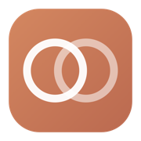

<h1>Claude Graft</h1>

<p>
  <b>1× is less but 5× is too much.</b> <i>(Or 20× is less, lol.)</i><br>
  Run multiple Claude Desktop accounts side by side on Mac or Windows.
</p>

<p>
  <a href="https://github.com/aaditya-v-more/claude-graft/releases/latest"></a>
  <a href="https://github.com/aaditya-v-more/claude-graft/releases"></a>
  <a href="https://github.com/aaditya-v-more/homebrew-claude-graft"></a>
  <a href="windows/README.md#install"></a>
  
  <a href="https://github.com/aaditya-v-more/claude-graft/stargazers"></a>
  <a href="LICENSE"></a>
  <a href="https://ko-fi.com/aadityavmore"></a>
</p>

<p>
  <a href="https://graft.aadityamore.com/"><b>Website</b></a>
  &nbsp;·&nbsp;
  <a href="#install"><b>Install</b></a>
  &nbsp;·&nbsp;
  <a href="https://github.com/aaditya-v-more/claude-graft/releases"><b>Releases</b></a>
</p>

<br>

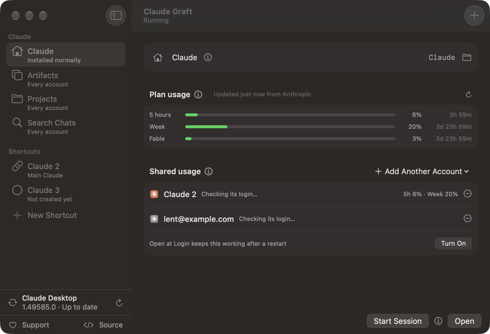

</div>

One Claude login is never quite the right amount. Claude Graft runs all your
Claude accounts at the same time, each in its own Claude Desktop and signed in
on its own, so switching never means signing out. They share their usage too:
when one account nears its five-hour or weekly limit, Claude Code carries on
with another's. Graft lives in the Mac menu bar or the Windows notification area. It is free and open source.

The Windows app was ported by [Tyler](https://github.com/snowtyler) with parts of [James](https://github.com/jamesql)'s port. The [Windows guide](windows/README.md) covers installing it, building it and how it differs.

## Install

Install Claude Desktop first on either platform.

**Windows (x64).** Download [ClaudeGraftApp-win-Setup.exe](https://github.com/aaditya-v-more/claude-graft/releases/download/v2.2.0/ClaudeGraftApp-win-Setup.exe), run it, then open **Claude Graft** from Start. The installer also sets up automatic updates. See the [Windows guide](windows/README.md#install).

**Mac (Intel or Apple silicon):** Install with Homebrew:

```sh
brew install --cask aaditya-v-more/claude-graft/claude-graft
```

Or take the **.dmg** from
[Releases](https://github.com/aaditya-v-more/claude-graft/releases). Graft needs
macOS 13 and Claude Desktop; sharing usage needs macOS 15. It is ad-hoc signed,
not notarised, so the first open needs **System Settings › Privacy & Security**
(the cask does this for you).

## Shared usage

When one account nears its five-hour or weekly limit, Claude Code carries on
with another's allowance, without leaving the Claude you are in. Under **Shared usage**, add another of
your Claudes or sign in to an account. Only the model's answers come from the
other account; your chats, files and connectors stay where they are. An account
you sign in to is also asked how much of its allowance is left, so Graft can
show it.

A conversation stays with the account that answered it until that account runs
out, so a chat you began on one allowance, or moved to it, is not carried off
to another between turns. Accounts are used in the order their weeks end, the
soonest first, and under **Accounts** you can put any of them ahead of the
rest. An account that is out of one model, or whose plan does not have it, is
passed over for that model alone and still answers for the others.

Sharing sends that Claude's Claude Code through a small relay Graft runs. Before
you remove Graft, take away the accounts each Claude borrows and close those
Claudes once, which puts their Code settings back as they were. If Graft goes
first, the relay puts each Claude back as it closes, then stops.

## A Claude for every account

**New Shortcut** makes a small app that opens Claude Desktop on a profile of its
own, so every account runs at the same time, side by side. Sign in once and it
stays signed in. It opens the Claude Desktop you already have, so there is no
second copy of Claude to keep up to date. A new Claude has its own chats;
reading another Claude's chats is a choice you make.

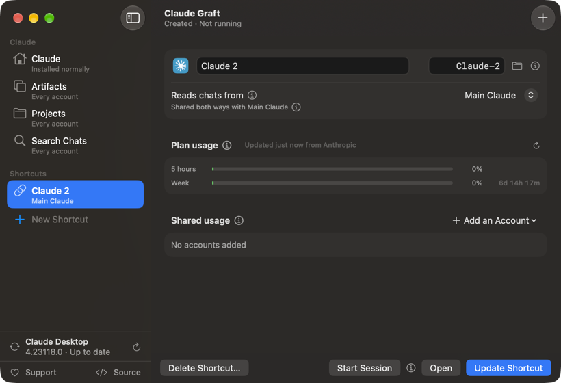

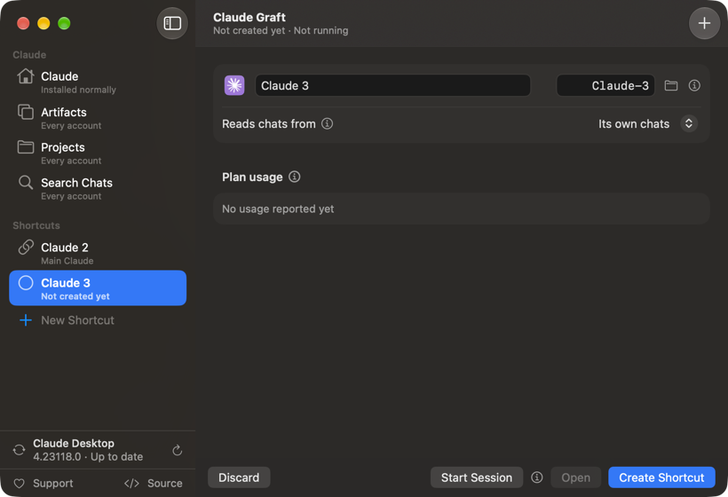

## The Mac menu bar

The menu bar says which Claude is in front, with its icon and its account's
usage, and its name too if you like. While a Claude shares usage, the bar shows
every account it draws on and rings the one answering right now in red, with
that account's usage beside it, and the conversation on screen runs across it
with that account's name, so you always know who is answering the chat in front
of you and how much it has left. An older chat that no account
has answered since you began sharing shows by its name alone. Archive or delete
a conversation and it leaves the bar. The dropdown lists each Claude with every
account it draws on, each by its address with its five-hour, weekly and Fable
usage, kept current while the Claudes are closed; switch it to **By account**
to see every account once instead. It also lets you pick which account answers
each conversation, with a tick beside the one in force.

**Start Session** opens an account's five-hour window with one short message.
**Auto-start** does that for you each time the account's window has closed, so
the next one is already running when you sit down to work. It is off until you
turn it on, one account at a time, in the dropdown or under **Accounts**, and
an account lent to several Claudes has the one switch wherever it is listed.

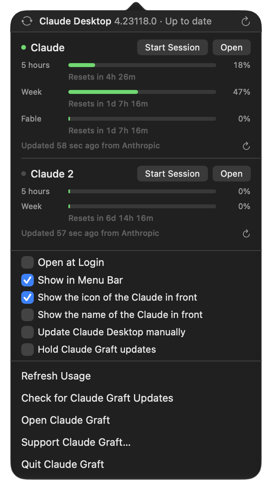

## Artifacts, projects and chats

Sign in with an emailed code and see every account's artifacts, projects and
chats in one place. Share an artifact with a group, each person as a viewer,
commenter or editor; rename, duplicate, delete, or export it as Markdown, PDF,
Word or page source. An address that belongs to more than one organization
picks which one to show from its own menu.

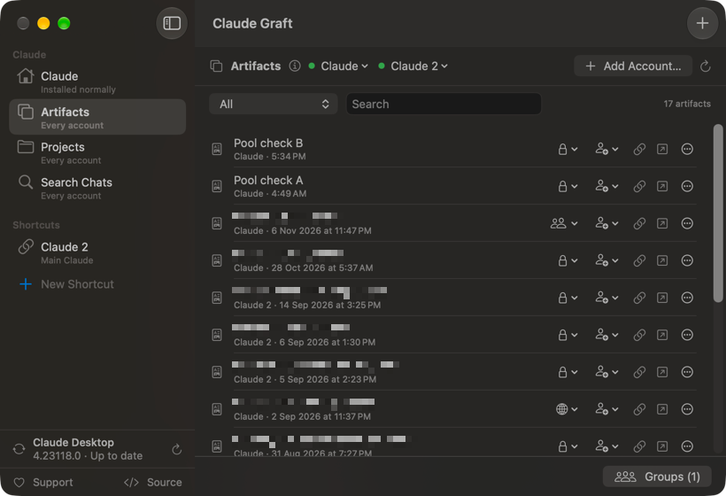

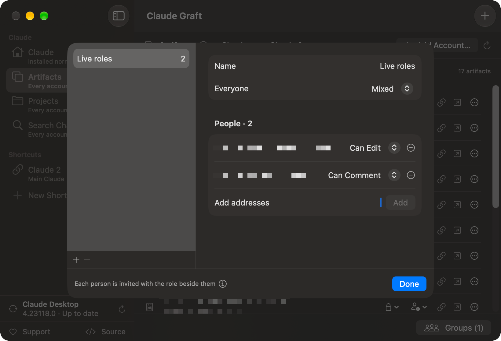

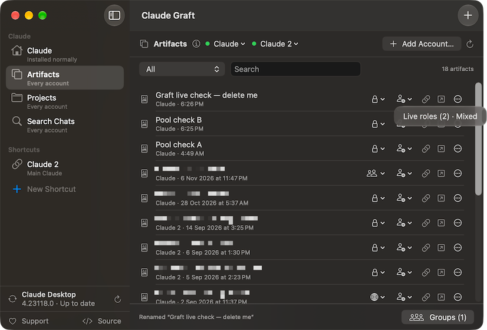

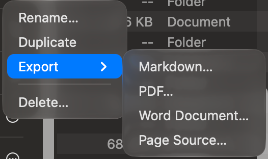

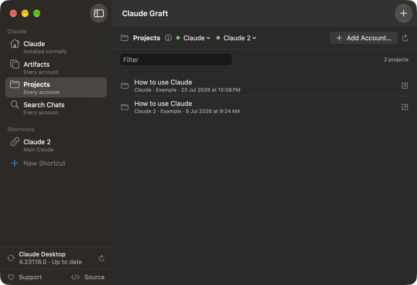

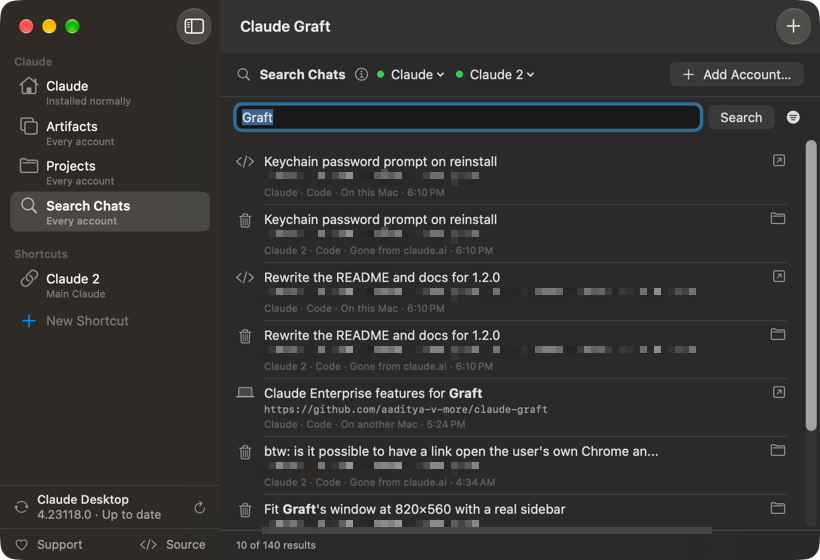

## Safe by design

Graft borrows each Claude's login rather than copying it, and its tokens go to
Anthropic alone. It never touches an app it did not make. Updating keeps every
Claude, setting and chat exactly as it was.

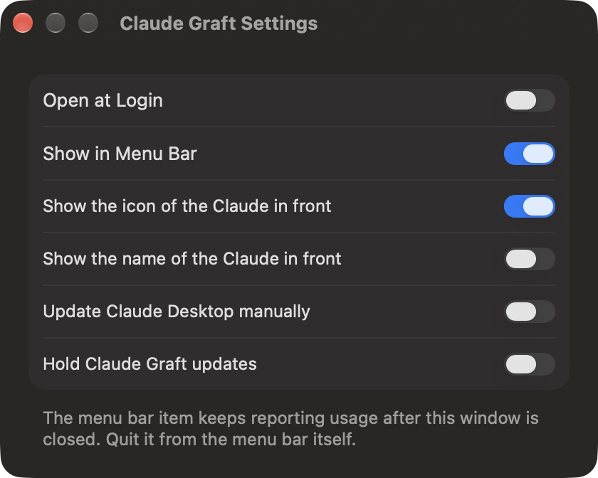

## Help

The Help menu has the guide, what's new, a way to report a problem and to
reach me.

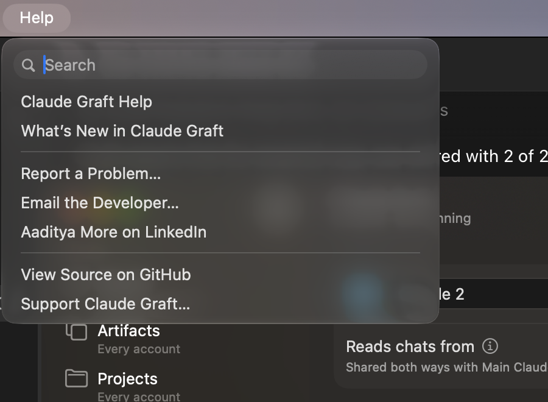

Made by Aaditya More: [aadityavmore@gmail.com](mailto:aadityavmore@gmail.com),
[LinkedIn](https://www.linkedin.com/in/aadityavmore/),
[issues](https://github.com/aaditya-v-more/claude-graft/issues/new). Graft is
free; the [tip jar](https://ko-fi.com/aadityavmore) keeps it going. Build it
with `./build.sh`. [MIT](LICENSE).
