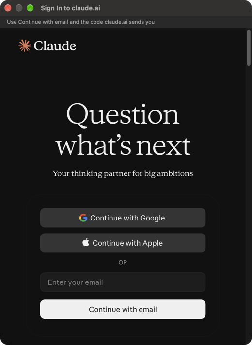

<div align="center">


<h1>Claude Graft</h1>

<p>
  <b>1× is less but 5× is too much.</b> <i>(Or 20× is less, lol.)</i><br>
  One Claude login is never quite the right amount.
</p>

<p>
  <a href="https://github.com/aaditya-v-more/claude-graft/releases/latest"></a>
  <a href="https://github.com/aaditya-v-more/claude-graft/releases"></a>
  <a href="https://github.com/aaditya-v-more/homebrew-claude-graft"></a>
  
  <a href="https://github.com/aaditya-v-more/claude-graft/stargazers"></a>
  <a href="LICENSE"></a>
  <a href="https://ko-fi.com/aadityavmore"></a>
</p>

<p>
  <a href="https://aaditya-v-more.github.io/claude-graft/"><b>Website</b></a>
  &nbsp;·&nbsp;
  <a href="#install"><b>Install</b></a>
  &nbsp;·&nbsp;
  <a href="https://github.com/aaditya-v-more/claude-graft/releases"><b>Releases</b></a>
</p>

<br>


</div>

Claude Graft is a menu bar app for people with more than one Claude account.
Claude Desktop signs into one account at a time, and signing out to switch
loses your place every time. Graft makes extra shortcuts that each open Claude
on a profile of its own, so every account stays signed in and you can run them
side by side. Each one is a small app with its own name, icon and
colour that you open from the Dock, Finder or Spotlight like any other.

Around that, Graft keeps an eye on all of your accounts at once. The menu bar
shows each account's usage and when it resets, whether its Claude is open or
not. A Claude can let its Claude Code draw on your other accounts' allowance
when its own runs low, without signing out of anything. And one window lists
the artifacts and projects of every account and searches all of their chats.

It is free, with no account of its own, no server and no telemetry. More on
[the site](https://aaditya-v-more.github.io/claude-graft/).

## Install

Graft needs macOS 13 Ventura or later and Claude Desktop installed in
`/Applications` or `~/Applications`. It runs natively on Apple Silicon and
Intel, in English and Russian. Lending usage between accounts needs macOS 15
Sequoia, and the claude.ai sign-ins behind Artifacts, Projects and Search Chats
are kept across restarts from macOS 14 on; on macOS 13 they last until Graft
quits. Everything else works on 13.

The easiest way in is Homebrew:

```sh
brew install --cask aaditya-v-more/claude-graft/claude-graft
```

Homebrew may ask you to trust this third-party tap first. Graft is ad-hoc
signed rather than notarised, because notarising needs a paid Apple developer
account, so the cask clears the quarantine flag macOS would otherwise refuse it
for. The command it runs is in the cask, in the open. If you would rather make
that call yourself, download the **.dmg** from
[Releases](https://github.com/aaditya-v-more/claude-graft/releases), drag Graft
into Applications and allow it in **System Settings › Privacy & Security** the
first time it opens.

Graft lives in the menu bar. Closing its window, or pressing ⌘Q there, leaves
the menu bar item running so it can go on reporting usage; **Quit Claude
Graft** in the dropdown is what stops it. Keep **Open at Login** on, which
matters once you share usage.

## Your Claudes

The window's sidebar lists the Claude you installed, then each Claude Graft has
made for you. Press **New Shortcut**, give it a name, pick an icon colour and
press **Create Shortcut**. Graft puts a small app of that name into your
Applications folder, which opens Claude on a profile folder of its own. Open it
and sign in to the other account, and from then on that account stays signed
in there while your first account stays signed in to Claude itself.


Each new Claude takes a colour no other Claude or lent account is wearing, so
two of them never look alike in the Dock, and nothing that already exists is
ever recoloured. The shortcut works without Graft running, and can be pointed
at an existing profile folder instead of a new one. Renaming it or changing its
icon is **Update Shortcut**. Pressing a shortcut whose Claude is already open
brings that Claude forward rather than starting a second copy on the same
profile.


A new Claude starts with chats of its own, which is what you want when the
point is a second account with its own history. **Reads chats from** lets it
share another Claude's chats instead, and that is a choice you make on purpose:
see [Sharing chats](#sharing-chats-between-claudes) for what it does, because
it cannot be fully undone.

One thing Graft cannot change is how a running Claude looks in the Dock. Every
shortcut runs the same Claude app, so macOS shows each running one with
Claude's own name and icon, whichever profile it is on. The shortcut's tile,
kept in the Dock, has its own name and icon and brings its Claude forward. The
menu bar says which one is in front instead: while a Claude is in front, Graft's
item carries that shortcut's icon beside its account's usage, and **Show the
name of the Claude in front** in Settings adds its name.

Deleting a shortcut asks whether to keep its profile folder. Keeping it, the
default, keeps that account's login and history on disk for a shortcut made
later to adopt.

## Usage in the menu bar

The menu bar item shows the usage of the account that matters right now, and
its dropdown lists every account with its five-hour and weekly figures, when
each resets and how recent the figure is. Figures stay current while the
Claudes are closed: Graft asks Anthropic directly every few minutes, more often
for a Claude that is open, and straight away when you open the dropdown or
bring a Claude to the front. Each account has a refresh button of its own.

To ask, Graft borrows the access token each Claude already keeps for its
account. macOS asks once whether Graft may read it from the keychain; choose
**Always Allow**. A Graft that has just updated itself may ask again.

Some plans now have only a weekly limit. For those Graft says there is no
five-hour limit in place of that bar and puts the weekly figure in the menu bar
with a W in front of it, so W 94% means 94% of the week and is never mistaken
for a five-hour figure.

**Start Session** sends one short message to an account to open its five-hour
window now rather than at your first message, so the window resets sooner. It
uses a few tokens and runs only when you press it, never on its own.

## Sharing usage between accounts

Any Claude can let its Claude Code draw on your other accounts, so a long
session goes on when one account's allowance runs out, and you never leave the
Claude you are working in. Select it in Graft's window and, under **Shared
usage**, choose **Add an Account**: pick another of your Claudes, or **Sign In
to Another Account…** to add one through your browser without making a
shortcut for it. An account signed in that way lasts a year. Each lent account
takes a colour of its own; one that is already a Claude here wears that
Claude's.

Only the model's answers come out of the other accounts. The chat, its
artifacts, connectors, Claude in Chrome and Remote Control all stay with the
Claude's own account, and the Chat tab is never shared at all, since it talks
to claude.ai directly. A request that refers to an uploaded file, a code
execution container or a connector Anthropic runs stays home too, because those
belong to the account that made them.

Each request goes to the account whose weekly limit resets soonest, as long as
it has room, and moves on when it fills. A conversation stays on one account
while its cached context is warm there, so that context is not paid for twice,
and one that carries the model's earlier reasoning stays on the account that
wrote it until that account is full, so the reasoning is not lost on a move.

While a Claude is sharing, the menu bar shows every account it draws on, its
own first, with the one answering its newest conversation drawn full size. A
conversation that has just begun runs across the menu bar for two minutes with
the account answering it; right-click the item to move it. The dropdown lists
recent conversations, the Claude in front first, and lets you pick which
account answers each one, or leave it on **Automatic**.

Graft makes this work by running a small relay on `127.0.0.1` and pointing that
Claude's Claude Code at it, a setting it only ever changes while that Claude is
closed: at once if it is, otherwise once it quits, so sharing starts the next
time the Claude opens. Removing the last account takes the setting out the
same way. A proxy or certificate you set there yourself is left alone, and the
pane says that nothing is shared. The relay keeps running when Graft quits or
updates, so a conversation is never cut off halfway; after a restart, a Claude
set up this way waits for it, which is why **Open at Login** should stay on.
Before deleting Graft, remove the accounts and let each of those Claudes close
once while Graft runs.

The relay unwraps only requests to `api.anthropic.com`. The certificate it
uses for that comes from an authority Graft makes on your Mac that can vouch
for that one name and nothing else, and its key is thrown away as soon as the
certificate is signed. Everything else Claude Code sends passes through it
untouched. An account lent by another of your Claudes lends the login that
Claude last saved, so open it now and then.

Read Anthropic's terms for your plans before sharing them. A request answered
by another account carries your conversation to that account.

## Artifacts, projects and chats across accounts

Three panes in the sidebar reach claude.ai for every account you sign in to
there: **Artifacts**, **Projects** and **Search Chats**. They share one sign-in
per account, so an account signed in from any of them appears in all three.

The login Graft borrows for usage cannot reach claude.ai, so each account is
signed in once more, in a window of Graft's. Choose **Continue with email** and
type the code claude.ai sends you; that is the one way of signing in Graft
supports. The sign-in stays in a web store of its own for that account, which
only claude.ai's pages ever use. Graft never reads it or sends it anywhere, and
**Sign Out** deletes it.



### Artifacts

**Artifacts** lists the artifacts of every signed-in account together, the
most recently viewed first, with the account each belongs to. Narrow it to the ones you made or the ones
shared with you, or search them by title. From the list you can open one in the
browser, copy its link, and decide who can open it: only the people you invited,
or anyone with the link.


You can also share an artifact with a group. claude.ai has groups only for
team organizations, so these are Graft's own, kept on your Mac: a name, a list
of email addresses, and what each person may do, **Can View**, **Can Comment**
or **Can Edit**. Sharing with a group invites each person with their role, and
claude.ai emails them just as it does when you invite someone yourself. Paste
addresses one per line or straight out of an email's header. If an artifact
does not take comments or edits, a person is invited with the most it does
take, never more than you asked, and Graft says how many were.


Each artifact's **⋯** menu offers what claude.ai's own does: **Rename** and
**Delete** for one you own, **Duplicate** where claude.ai allows a copy, and
**Export**. Delete asks first, because claude.ai keeps no copy and everyone it
was shared with loses it too. Export saves the artifact as **Markdown**,
**PDF** or a **Word Document**, drawn from the page as it appears, so an
artifact that builds itself with script exports what you see rather than an
empty shell; **Page Source** saves its files, zipped when there are several.
Exports are drawn on your Mac with no sign-in anywhere near them.


Graft asks claude.ai for artifacts when you show the pane or press refresh,
never on a timer.

### Projects

**Projects** lists the projects of every signed-in account together, with
the account each belongs to, and opens any of them in the browser.


### Search Chats

**Search Chats** searches the chats and Claude Code sessions of every
signed-in account at once. It searches when you press Return, never as you
type. Filters narrow it by kind, whether a chat is active or archived, which
account and project it is in, how recently it changed, whether it is starred,
and for a Code session where it ran: on this Mac, on another Mac, in the cloud,
or gone from claude.ai while its transcript is still here, in which case Graft
shows the transcript in Finder. Changing a filter asks claude.ai nothing new.


## Sharing chats between Claudes

A Claude can read another Claude's chats instead of its own, which suits two
accounts that work on the same projects and want one Claude Code history
between them. Choose the other Claude under **Reads chats from**.

Sharing merges the two histories. Both sidebars end up showing the combined
set, and Graft carries changes both ways each time either Claude is opened, so
a chat started, renamed, archived or deleted in one shows up in the other.
Switching back to the Claude's own chats returns it to exactly what it had, but
the copies of its chats already merged into the other Claude stay there:
merging is the one thing Graft does that it cannot take back. Back up your
profiles first if you need an untouched copy.

Pinned chats, their order and the Code sort choice carry across as well, once
the linked Claudes are closed: open each one's Code sidebar once, quit both,
and open either shortcut. Graft backs up the sidebar settings before it changes
them and leaves them alone if it cannot sync safely. Custom groups and Cowork
settings stay with each Claude. A sharing Claude also gets the local MCP
servers it is missing, while its own server settings, its permission mode and
its connectors stay its own.

Claude saves no session record into a chat folder that lives outside its own
profile, so a session can close without one, most often in a Claude that shares
another's chats, and then it is missing from every sidebar. Graft files the
missing record itself, from the session's own transcript, whenever a shortcut
opens, Graft starts or the dropdown opens, and the dropdown says when it
recovered one. It never brings back a session you deleted or unarchives one you
archived. Sessions carried over from another Mac are left out of the
sidebar rather than listed as broken.

If a new Claude comes up with an empty sidebar because its account's chats are
still in a profile you used before, Graft finds them and offers **Copy Them
Here**. That copies what is missing once and leaves the originals where they
were. Quit every Claude first.

## What Graft leaves alone

Graft borrows credentials and never takes them. It decrypts only the access
token each Claude keeps, never the refresh token, because using that would sign
Claude out. It writes nothing back to Claude's login, cookies or keychain. A
token goes only to `api.anthropic.com`. Signing in an account for shared usage
sends only the browser's one-time code to `platform.claude.com`, and claude.ai
sees only the sign-ins you make in Graft's own window. Claude's own cookies are
never read.

Graft never touches an app it did not make. It recognises its shortcuts by a
file inside each one, never by name, so Claude itself is never renamed, moved,
modified or deleted, and the names Claude and Claude Graft are refused for a
shortcut. Claude's own profile is never re-pointed or deleted from Graft
either, and anything a shortcut's link would replace in a profile is put aside
first, never thrown away. Graft writes only into the profiles of Claude and the
Claudes it made, and into Claude's own profile only for what you set up: chats
shared with it, the session records a sharing Claude would otherwise lose, the
Claude Code setting for shared usage and the update mode below. A profile
anything else made is read, never written to.

## Updating

Graft checks for its own updates hourly and installs them by itself, signed
and verified, with no dialog; the menu bar item blinks out and back while it
restarts. **Check for Claude Graft Updates** does the same thing now. To decide
when Graft updates, turn on **Hold Claude Graft updates**: it keeps checking,
shows a new version in the dropdown, and installs it only when you press it.


Claude's own updater restarts Claude when it has been idle a while, which ends
the Claude Code sessions running in it and brings back plain Claude in place of
the shortcut you were using. If you would rather choose the moment, turn on
**Update Claude Desktop manually**; it applies when each Claude next starts. The
Claude Desktop line in Graft's window and dropdown turns red when a release is
ready, and **Update Claude…** asks before closing every Claude and installs it
through Claude's own updater, which Graft keeps hidden and signed out. Your
logins, settings and shortcuts stay in place. If Claude's updater does reopen
the wrong Claude while Graft is running, Graft puts the shortcut you were using
back.

### Coming from an earlier version

From any 1.1 release, 2.0.0 installs itself like every other update, unless you
held updates. Nothing you set up changes: a Claude that was reading another
Claude's chats goes on reading them, one with its own chats keeps them, and
every Claude keeps the icon it had. Only Claudes you make from now on start
with their own chats. The shortcuts in your Applications folder are brought up
to date the first time the new Graft starts, so they behave like it whether you
open them from Graft or from the Dock. Shared usage stays off until you add an
account to a Claude, and the three claude.ai panes ask nothing until you sign
in to them.

From a 1.0 release, Graft asks before installing, once: 1.1 changed sharing
chats to merge both histories, which cannot be undone, so it is not done to
anyone without asking. After that, updates are quiet again.

Homebrew records the version it installed and leaves updating to Graft, so
`brew upgrade` does not reinstall over a copy that has already moved on.

## Worth knowing

**Avoid using the same conversation in two Claudes at once** when they share
chats: both write the same files, and messages can be lost. Graft asks before
opening a Claude whose chats another open Claude is reading, from its window or
its dropdown; opening a shortcut straight from the Dock skips that question.

**Archiving the same conversation differently in both** between two openings
leaves the one touched last.

**Old chats may show “Session not found on disk”** once Claude Code has pruned
their transcripts. Raise `cleanupPeriodDays` in `~/.claude/settings.json` to
keep them longer.

**VoiceOver and automation reach every control.** Each button, switch and field
in Graft's window, dropdown and Settings says what it does and which account it
acts on, and has a fixed identifier, such as `dropdown.Claude-2.open` or
`settings.hold-updates`, that reads the same in every language.

**When something looks wrong,** `~/Library/Application Support/ClaudeGraft/`
holds `diagnostics.log`, which records every decision Graft makes, and
`state-report.txt`, which says what is true right now. They carry profile names,
folder paths and account identifiers, never chat titles, messages or tokens.
While Graft's window is open, its **Help** menu leads to the site, what's new
in each release, a new issue on GitHub, an email to the developer already
carrying your Graft and macOS versions, which are the first two things anyone
will ask, the developer's LinkedIn profile, the source and the tip jar.


## How it works

Claude Code transcripts live in the shared `~/.claude/projects` folder, which
every Claude reads. What differs between profiles is the sidebar's records,
kept under each profile's account. When a Claude shares another's chats, Graft
gives it a real copy of those records and carries changes both ways, so Claude
can save renames and archives, while a few settings are shared through links.

<picture>
  <source media="(prefers-color-scheme: dark)" srcset="docs/assets/layout-dark.svg">
  
</picture>

Each shortcut prepares its profile and syncs changes before opening Claude.

<picture>
  <source media="(prefers-color-scheme: dark)" srcset="docs/assets/launch-dark.svg">
  
</picture>

The first shared launch puts the profile's own chats aside in a hidden
`.graft-own` folder and merges both histories. That saved set is what lets it
go back to its own chats later.

<picture>
  <source media="(prefers-color-scheme: dark)" srcset="docs/assets/merge-dark.svg">
  
</picture>

## Building it

```sh
./build.sh                  # The app, into build.noindex/
./test.sh                   # The suite, in a throwaway directory
./test-layout.sh            # Window layout and VoiceOver checks; needs Accessibility access
./test-opening.sh           # Launch paths against disposable, signed-out profiles
./test-sidebar.sh           # Sidebar sync against real browser storage in disposable profiles
./test-relay.sh             # The usage relay over loopback, against a stand-in service
./release.sh                # Test, build both architectures, sign and package
Tools/render-diagrams.sh    # Render the diagrams above into docs/assets
```

It needs Xcode's Swift toolchain and nothing else installed first: the first
build fetches a pinned, checksum-verified Sparkle release, and `VERSION` sets
the app's version. The sidebar suite needs Node and Claude Desktop; the app
itself needs no Node.

## Contributing

Bug reports and patches are welcome. Read [CONTRIBUTING.md](CONTRIBUTING.md),
and [CLAUDE.md](CLAUDE.md) with the note it links for the area, before changing
anything that touches a profile, a credential or the menu bar. Pushes and pull
requests run the suite and a universal build.

## Contact

Graft is made by Aaditya More. Report a problem as a
[GitHub issue](https://github.com/aaditya-v-more/claude-graft/issues/new), or
write to [aadityavmore@gmail.com](mailto:aadityavmore@gmail.com); **Email the
Developer…** in the Help menu fills in the versions for you. Aaditya is also on
[LinkedIn](https://www.linkedin.com/in/aadityavmore/).

## Supporting it

Graft is free. If it helps, the [tip jar](https://ko-fi.com/aadityavmore) keeps
it going.

## Licence

[MIT](LICENSE).
