<div align="center">


<h1>Claude Graft</h1>

<p>
  <b>1× is less but 5× is too much.</b> <i>(Or 20× is less, lol.)</i><br>
  One Claude login is never quite the right amount.
</p>

<p>
  <a href="https://github.com/aaditya-v-more/claude-graft/releases/latest"></a>
  <a href="https://github.com/aaditya-v-more/claude-graft/releases"></a>
  <a href="https://github.com/aaditya-v-more/homebrew-claude-graft"></a>
  
  <a href="https://github.com/aaditya-v-more/claude-graft/stargazers"></a>
  <a href="LICENSE"></a>
  <a href="https://ko-fi.com/aadityavmore"></a>
</p>

<p>
  <a href="https://aaditya-v-more.github.io/claude-graft/"><b>Website</b></a>
  &nbsp;·&nbsp;
  <a href="#install"><b>Install</b></a>
  &nbsp;·&nbsp;
  <a href="https://github.com/aaditya-v-more/claude-graft/releases"><b>Releases</b></a>
</p>

<br>

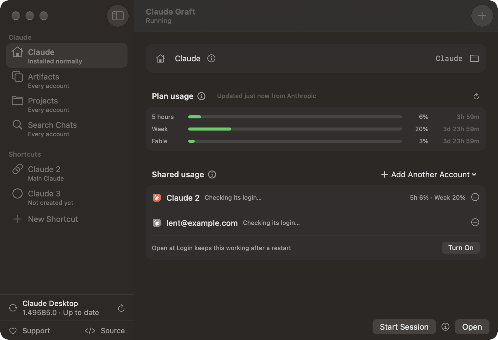

</div>

Claude Graft runs every Claude account you have side by side, each signed in
on its own profile, and lets them share their usage. It lives in the menu bar.

## Install

```sh
brew install --cask aaditya-v-more/claude-graft/claude-graft
```

Or take the **.dmg** from
[Releases](https://github.com/aaditya-v-more/claude-graft/releases). Graft needs
macOS 13 and Claude Desktop; sharing usage needs macOS 15. It is ad-hoc signed,
not notarised, so the first open needs **System Settings › Privacy & Security**
(the cask does this for you).

## Shared usage

When one account runs out, Claude Code carries on with another's allowance,
without leaving the Claude you are in. Under **Shared usage**, add another of
your Claudes or sign in to an account. Only the model's answers come from the
other account; your chats, files and connectors stay where they are.

## A Claude for every account

**New Shortcut** makes a small app that opens Claude on a profile of its own.
Sign in once and it stays signed in. A new Claude has its own chats; reading
another Claude's chats is a choice you make.

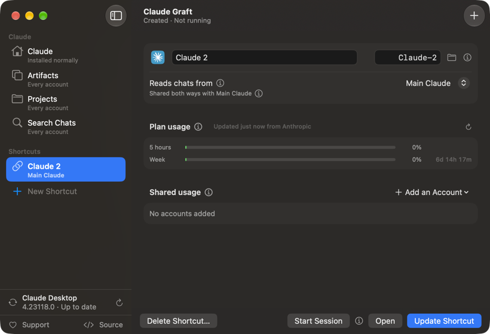

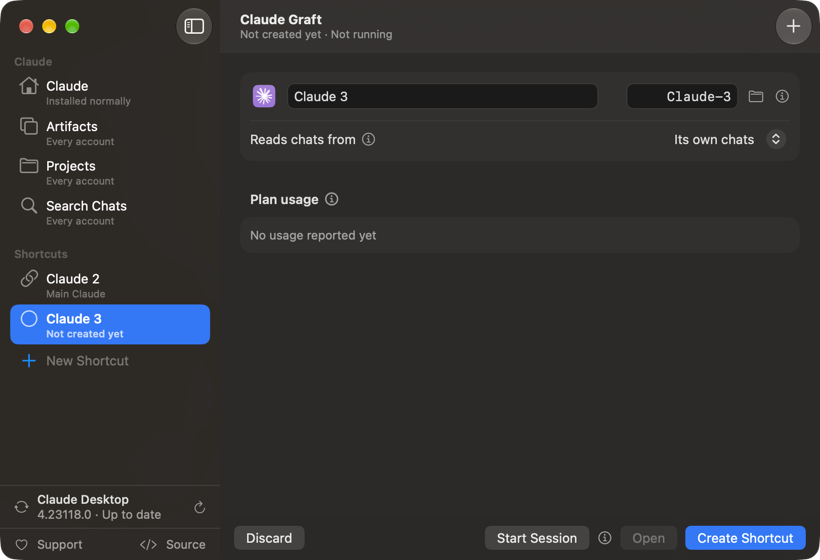

## The menu bar

The menu bar says which Claude is in front, with its icon and its account's
usage, and its name too if you like. While a Claude shares usage, the bar shows
every account it draws on and lights the one answering right now; a
conversation that has just begun runs across it for two minutes, so you see
which account took it. The dropdown lists every account's five-hour and weekly
usage, kept current while the Claudes are closed, and lets you pick which
account answers each conversation.

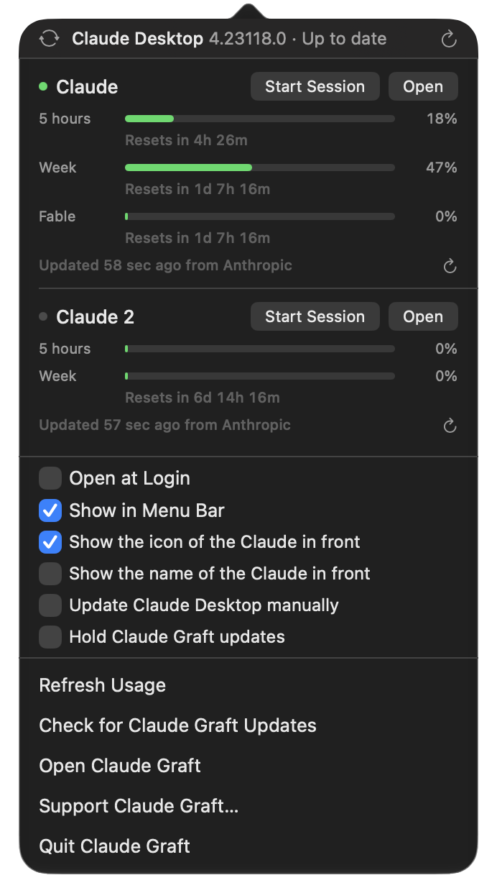

## Artifacts, projects and chats

Sign in with an emailed code and see every account's artifacts, projects and
chats in one place. Share an artifact with a group, each person as a viewer,
commenter or editor; rename, duplicate, delete, or export it as Markdown, PDF,
Word or page source.

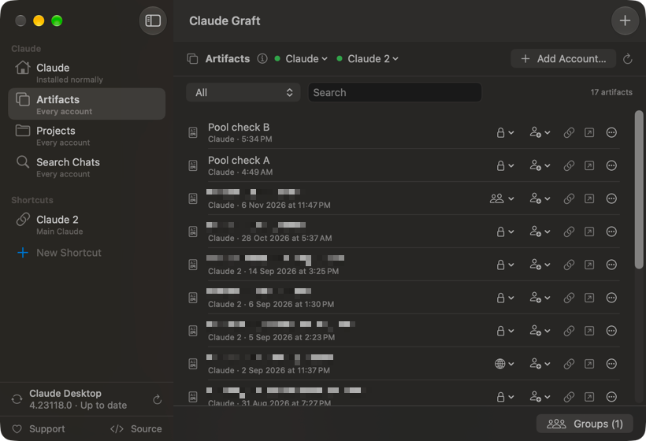

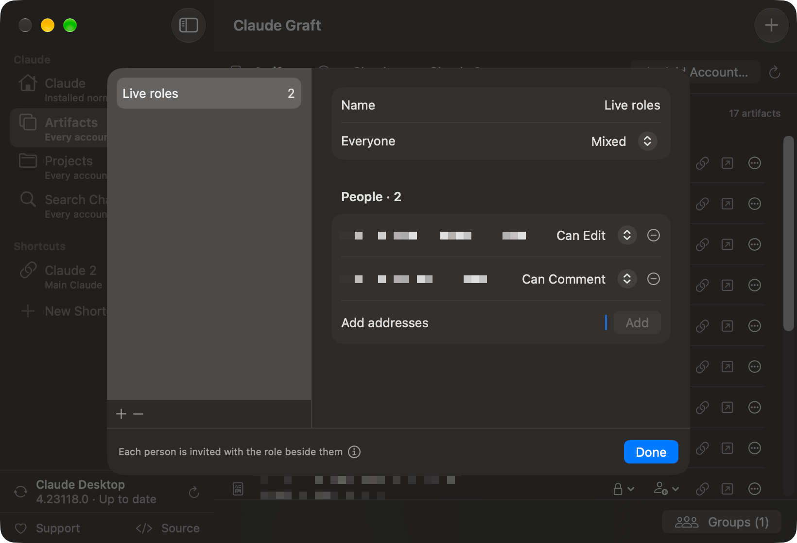

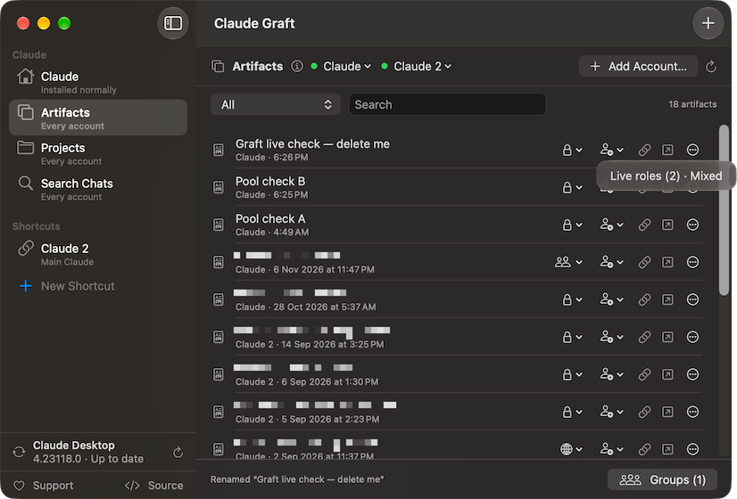

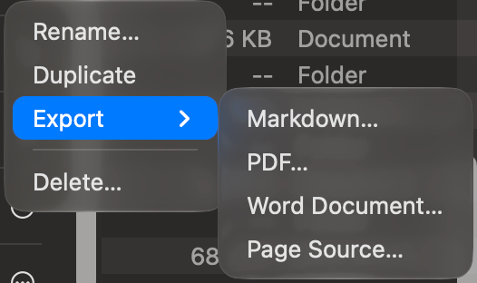

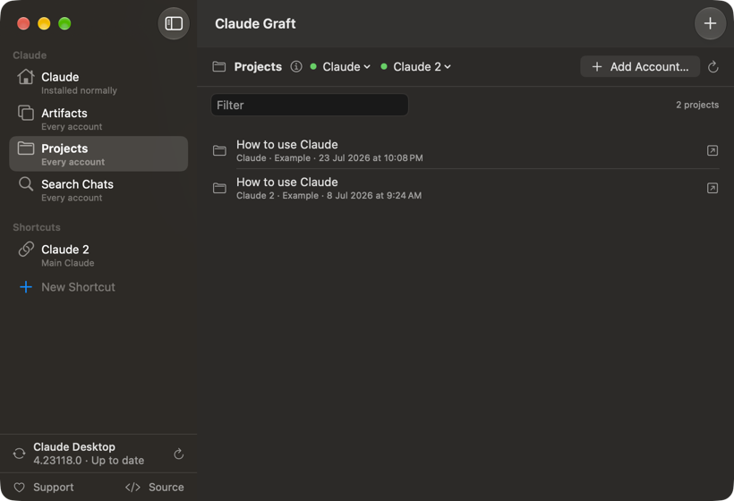

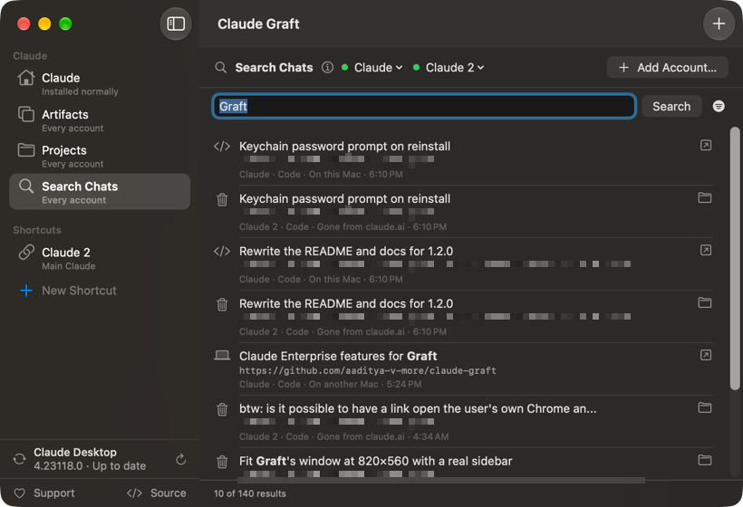

## Safe by design

Graft borrows each Claude's login rather than copying it, and its tokens go to
Anthropic alone. It never touches an app it did not make. Updating keeps every
Claude, setting and chat exactly as it was.

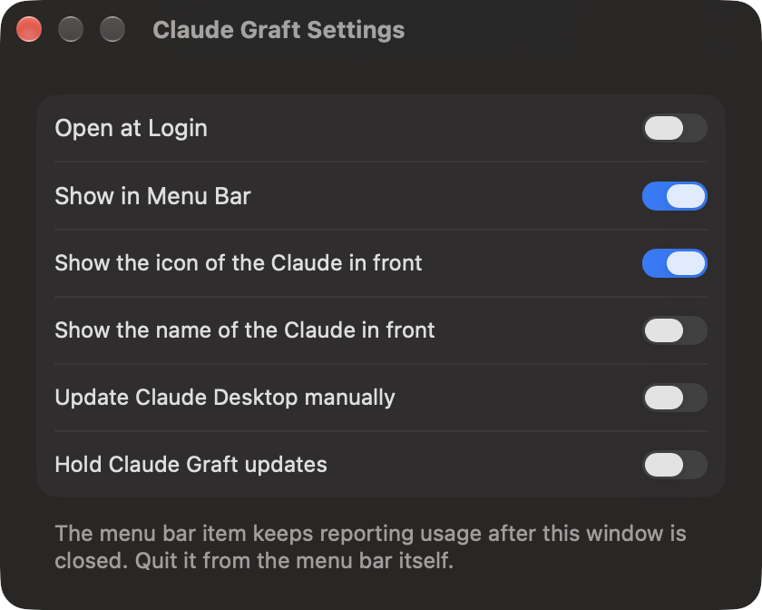

## Help

The Help menu has the guide, what's new, a way to report a problem and to
reach me.

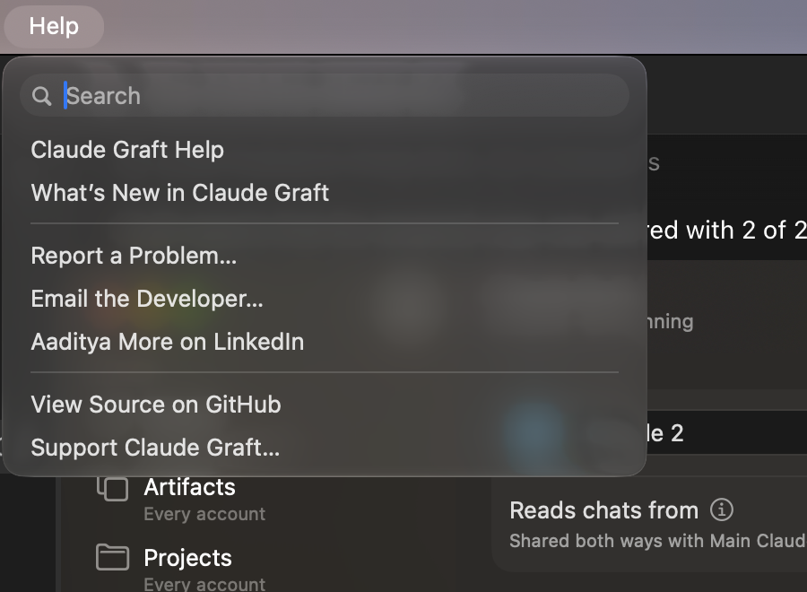

Made by Aaditya More: [aadityavmore@gmail.com](mailto:aadityavmore@gmail.com),
[LinkedIn](https://www.linkedin.com/in/aadityavmore/),
[issues](https://github.com/aaditya-v-more/claude-graft/issues/new). Graft is
free; the [tip jar](https://ko-fi.com/aadityavmore) keeps it going. Build it
with `./build.sh`. [MIT](LICENSE).
